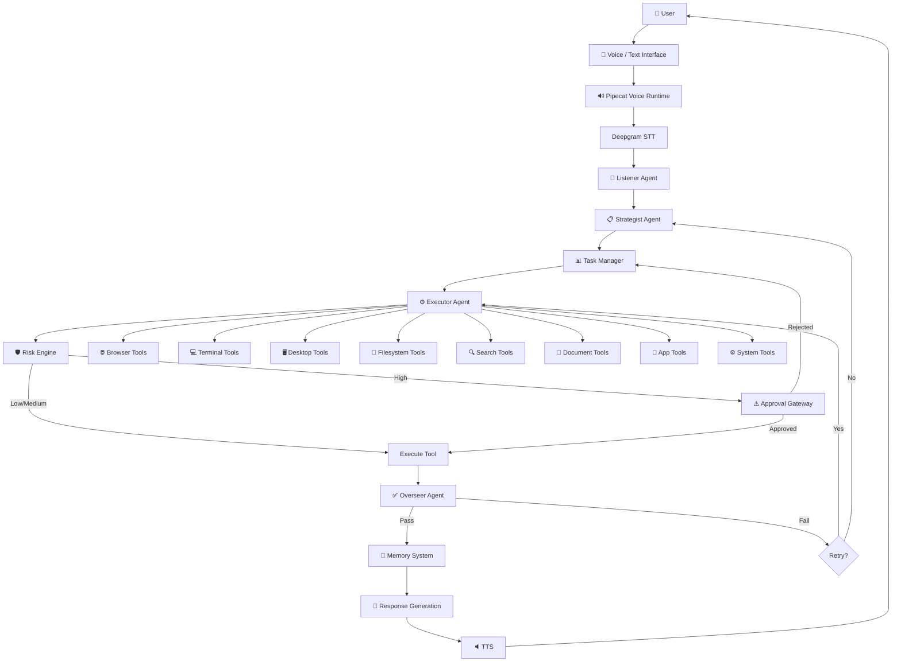
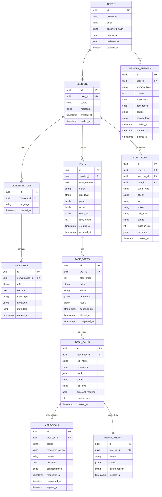
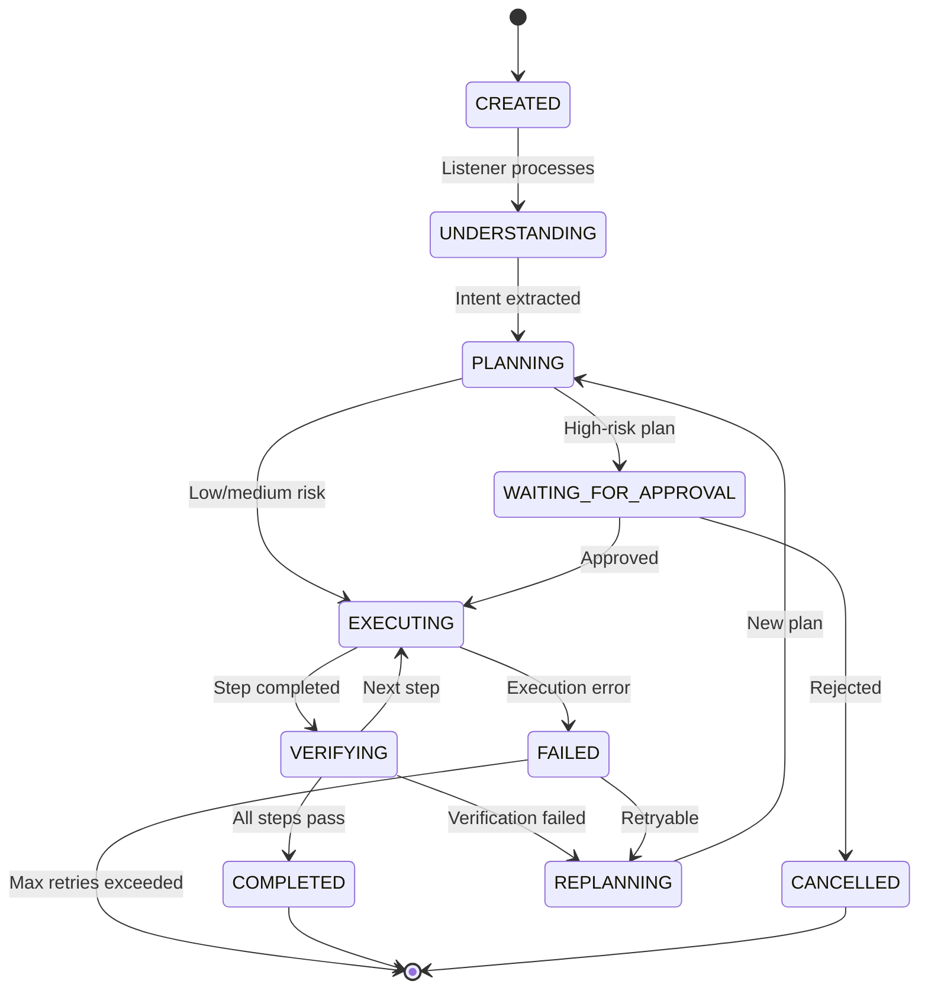
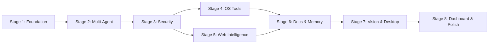

# VoxOS — Autonomous Multilingual Desktop AI Agent

## Implementation Plan

> A permissioned, voice-first, multilingual, multi-agent desktop AI assistant capable of planning, executing, and verifying complex tasks — built as a final-year engineering project.

---

## 1. Architecture Overview



### Core Security Principle

```
LLM → Structured Tool Request → Risk Classification → Permission Check → Human Approval (if required) → Tool Executor → Overseer Verification
```

> [!CAUTION]
> The LLM must **NEVER** directly possess unrestricted OS authority. Every action flows through registered, controlled tools with risk classification.

---

## 2. Agent Responsibilities (Separation of Concerns)

| Agent | Question It Answers | Can Execute Tools? |
|-------|--------------------|--------------------|
| **Listener** | "What does the user want?" | ❌ Never |
| **Strategist** | "How should we accomplish it?" | ❌ Never |
| **Executor** | "Perform the approved actions" | ✅ Via Tool Registry only |
| **Overseer** | "Did it actually work?" | ✅ Read-only verification only |

---

## 3. Technology Stack

| Layer | Technology | Rationale |
|-------|-----------|-----------|
| **Language** | Python 3.11+ | Ecosystem, Pipecat compatibility |
| **Web Framework** | FastAPI | Async, Pydantic integration, WebSocket support |
| **Validation** | Pydantic v2 | Type safety, serialization, settings |
| **ORM** | SQLAlchemy 2.0 (async) | Mature, flexible, async support |
| **Database** | PostgreSQL | Durable state, JSONB for flexible data |
| **Cache/Events** | Redis | Session state, pub/sub events, caching |
| **Voice Runtime** | Pipecat | Real-time voice pipeline, frame-based |
| **STT** | Deepgram (nova-3/flux) | Streaming, multilingual, free tier |
| **TTS** | edge-tts (initial) → Kokoro/provider swap | Free, decent quality, swappable |
| **LLM** | OpenAI-compatible API (Groq/local/OpenAI) | Cost-aware model routing |
| **Browser** | Playwright | Headless automation, semantic selectors |
| **Desktop** | pyautogui + pywinauto (Windows) | Native API + accessibility tree |
| **Migrations** | Alembic | Schema versioning |
| **Testing** | pytest + pytest-asyncio | Async test support |
| **Package Mgmt** | uv (recommended) or pip + venv | Modern Python tooling |

---

## 4. Repository Structure

```
voxos/
│
├── pyproject.toml                    # Dependencies, project metadata
├── alembic.ini                       # Migration config
├── .env.example                      # Environment template (no secrets)
├── docker-compose.yml                # PostgreSQL + Redis + app
├── README.md
├── Makefile                          # Common commands
│
├── alembic/                          # Database migrations
│   ├── env.py
│   └── versions/
│
├── voxos/                           # Main Python package
│   ├── __init__.py
│   ├── main.py                       # FastAPI app entry
│   ├── config.py                     # Pydantic Settings
│   │
│   ├── api/                          # REST API layer
│   │   ├── __init__.py
│   │   ├── v1/
│   │   │   ├── __init__.py
│   │   │   ├── router.py            # Main router aggregator
│   │   │   ├── chat.py              # POST /chat
│   │   │   ├── tasks.py             # Task CRUD + cancel
│   │   │   ├── approvals.py         # Approval endpoints
│   │   │   ├── tools.py             # Tool listing
│   │   │   ├── memory.py            # Memory CRUD
│   │   │   ├── system.py            # System status
│   │   │   └── audit.py             # Audit log queries
│   │   ├── deps.py                   # Shared dependencies (get_db, get_user)
│   │   └── websocket.py             # WebSocket for real-time updates
│   │
│   ├── agents/                       # Four core agents
│   │   ├── __init__.py
│   │   ├── base.py                   # BaseAgent ABC
│   │   ├── listener/
│   │   │   ├── __init__.py
│   │   │   ├── agent.py             # ListenerAgent
│   │   │   ├── intent.py            # Intent classification
│   │   │   ├── entities.py          # Entity extraction
│   │   │   └── language.py          # Language detection
│   │   ├── strategist/
│   │   │   ├── __init__.py
│   │   │   ├── agent.py             # StrategistAgent
│   │   │   ├── planner.py           # Plan generation
│   │   │   └── decomposer.py        # Task decomposition
│   │   ├── executor/
│   │   │   ├── __init__.py
│   │   │   ├── agent.py             # ExecutorAgent
│   │   │   └── runner.py            # Tool execution engine
│   │   └── overseer/
│   │       ├── __init__.py
│   │       ├── agent.py             # OverseerAgent
│   │       └── verifiers.py         # Verification strategies
│   │
│   ├── core/                         # Core subsystems
│   │   ├── __init__.py
│   │   ├── task_manager/
│   │   │   ├── __init__.py
│   │   │   ├── manager.py           # TaskManager orchestrator
│   │   │   ├── models.py            # Task, TaskStep Pydantic models
│   │   │   └── state.py             # State machine, transitions
│   │   ├── context/
│   │   │   ├── __init__.py
│   │   │   ├── builder.py           # Context construction
│   │   │   └── window.py            # Token-aware windowing
│   │   ├── memory/
│   │   │   ├── __init__.py
│   │   │   ├── manager.py           # Memory retrieval/storage
│   │   │   ├── models.py            # MemoryEntry
│   │   │   └── relevance.py         # Contextual retrieval
│   │   ├── events/
│   │   │   ├── __init__.py
│   │   │   ├── bus.py               # EventBus (Redis-backed)
│   │   │   ├── types.py             # Event type enums
│   │   │   └── handlers.py          # Event handlers
│   │   ├── permissions/
│   │   │   ├── __init__.py
│   │   │   └── manager.py           # Permission checking
│   │   ├── policies/
│   │   │   ├── __init__.py
│   │   │   └── risk.py              # Risk policies
│   │   └── risk_engine/
│   │       ├── __init__.py
│   │       ├── engine.py            # RiskEngine
│   │       ├── classifier.py        # Command risk classification
│   │       └── approval.py          # ApprovalGateway
│   │
│   ├── tools/                        # Tool registry + implementations
│   │   ├── __init__.py
│   │   ├── registry.py              # Central ToolRegistry
│   │   ├── base.py                  # BaseTool ABC, ToolResult
│   │   ├── filesystem/
│   │   │   ├── __init__.py
│   │   │   └── tools.py             # list, read, create, copy, move, delete, etc.
│   │   ├── terminal/
│   │   │   ├── __init__.py
│   │   │   └── tools.py             # execute, cwd, processes, kill
│   │   ├── browser/
│   │   │   ├── __init__.py
│   │   │   └── tools.py             # open, search, click, type, extract, screenshot
│   │   ├── desktop/
│   │   │   ├── __init__.py
│   │   │   └── tools.py             # screenshot, click, type, scroll
│   │   ├── applications/
│   │   │   ├── __init__.py
│   │   │   └── tools.py             # open, close, focus, list, status
│   │   ├── web_search/
│   │   │   ├── __init__.py
│   │   │   ├── base.py              # SearchProvider ABC
│   │   │   ├── provider.py          # Search implementation
│   │   │   ├── ranking.py           # Result ranking
│   │   │   ├── extraction.py        # Content extraction
│   │   │   └── citations.py         # Citation generation
│   │   ├── documents/
│   │   │   ├── __init__.py
│   │   │   └── tools.py             # read, create, summarize, extract
│   │   └── system/
│   │       ├── __init__.py
│   │       └── tools.py             # get_info, time, resources
│   │
│   ├── voice/                        # Voice subsystem
│   │   ├── __init__.py
│   │   ├── pipeline.py              # Pipecat pipeline setup
│   │   ├── session.py               # Voice session management
│   │   ├── stt/
│   │   │   ├── __init__.py
│   │   │   ├── base.py              # STTProvider ABC
│   │   │   └── deepgram.py          # Deepgram implementation
│   │   ├── tts/
│   │   │   ├── __init__.py
│   │   │   ├── base.py              # TTSProvider ABC
│   │   │   └── edge.py              # edge-tts implementation
│   │   └── vad/
│   │       ├── __init__.py
│   │       └── silero.py            # Silero VAD
│   │
│   ├── vision/                       # Computer vision (Stage 7)
│   │   ├── __init__.py
│   │   ├── screenshot.py
│   │   ├── ui_detection.py
│   │   └── screen_understanding.py
│   │
│   ├── llm/                          # LLM abstraction
│   │   ├── __init__.py
│   │   ├── base.py                  # LLMProvider ABC
│   │   ├── openai_compat.py         # OpenAI-compatible provider
│   │   ├── router.py               # Model routing (simple→cheap, complex→strong)
│   │   └── context.py              # Token-aware context construction
│   │
│   ├── database/                     # Database layer
│   │   ├── __init__.py
│   │   ├── engine.py                # Async engine, session factory
│   │   ├── models/                  # SQLAlchemy ORM models
│   │   │   ├── __init__.py
│   │   │   ├── base.py             # DeclarativeBase
│   │   │   ├── user.py
│   │   │   ├── session.py
│   │   │   ├── conversation.py
│   │   │   ├── message.py
│   │   │   ├── task.py
│   │   │   ├── tool_call.py
│   │   │   ├── approval.py
│   │   │   ├── verification.py
│   │   │   ├── memory.py
│   │   │   └── audit.py
│   │   └── repositories/            # Data access layer
│   │       ├── __init__.py
│   │       ├── base.py
│   │       ├── task_repo.py
│   │       ├── session_repo.py
│   │       ├── memory_repo.py
│   │       └── audit_repo.py
│   │
│   ├── security/                     # Security subsystem
│   │   ├── __init__.py
│   │   ├── auth.py                  # JWT, session tokens
│   │   ├── sandbox.py               # Path restrictions, workspace
│   │   ├── secrets.py               # Secret redaction
│   │   └── audit.py                 # Audit logging
│   │
│   └── observability/               # Metrics + structured logging
│       ├── __init__.py
│       ├── logger.py                # Structured JSON logger
│       ├── metrics.py               # Latency, counters, costs
│       └── tracing.py              # OpenTelemetry-compatible traces
│
├── apps/                            # Frontend applications
│   └── frontend/                    # Dashboard (Stage 8)
│       ├── index.html
│       ├── index.css
│       └── app.js
│
├── tests/                           # Test suite
│   ├── __init__.py
│   ├── conftest.py                  # Fixtures
│   ├── unit/
│   │   ├── test_listener.py
│   │   ├── test_strategist.py
│   │   ├── test_executor.py
│   │   ├── test_overseer.py
│   │   ├── test_risk_engine.py
│   │   ├── test_tool_registry.py
│   │   └── test_task_manager.py
│   ├── integration/
│   │   ├── test_agent_pipeline.py
│   │   └── test_tool_execution.py
│   ├── security/
│   │   ├── test_command_risk.py
│   │   ├── test_path_traversal.py
│   │   └── test_secret_exposure.py
│   └── e2e/
│       └── test_workflows.py
│
└── docs/                            # Documentation
    ├── ARCHITECTURE.md
    ├── SECURITY.md
    ├── API.md
    ├── AGENTS.md
    ├── TOOLS.md
    └── DEVELOPMENT.md
```

---

## 5. Database Schema



---

## 6. Agent Interfaces & Tool Contracts

### Agent Base Interface

```python
class BaseAgent(ABC):
    @abstractmethod
    async def process(self, input: AgentInput) -> AgentOutput: ...
```

### Tool Base Interface

```python
class BaseTool(ABC):
    name: str
    description: str
    risk_level: RiskLevel           # LOW, MEDIUM, HIGH, CRITICAL
    requires_confirmation: bool
    input_schema: type[BaseModel]
    output_schema: type[BaseModel]
    timeout_seconds: int
    verification_type: VerificationType  # NONE, AUTOMATIC, REQUIRED

    @abstractmethod
    async def execute(self, args: BaseModel) -> ToolResult: ...

    async def verify(self, args: BaseModel, result: ToolResult) -> VerificationResult: ...
```

### Task Lifecycle State Machine



---

## 7. Security Architecture

### Risk Classification Engine

```
Command Input
    ↓
┌─────────────────────┐
│  Static Analysis    │  ← Allowlist/denylist matching
├─────────────────────┤
│  Command Parsing    │  ← Parse command structure
├─────────────────────┤
│  Path Analysis      │  ← Workspace boundary check
├─────────────────────┤
│  Intent Analysis    │  ← Destructive? Privilege escalation?
├─────────────────────┤
│  Context Analysis   │  ← What files/resources affected?
└─────────────────────┘
    ↓
Risk Level: LOW | MEDIUM | HIGH | CRITICAL
```

### Approval Flow

```
Tool Request → Risk Engine → LOW → Execute immediately
                           → MEDIUM → Log + Execute
                           → HIGH → Approval Gateway → User confirms → Execute
                           → CRITICAL → Blocked (admin override only)
```

### Path Safety

- Workspace root defined per-user
- All filesystem operations validated against workspace
- `../` traversal blocked
- System-critical paths (`C:\Windows`, `/etc`, etc.) blocked by default
- Operations outside workspace require explicit HIGH-risk approval

---

## 8. Event System

```python
class EventType(str, Enum):
    USER_INPUT_RECEIVED = "user_input_received"
    INTENT_DETECTED = "intent_detected"
    PLAN_CREATED = "plan_created"
    TASK_STARTED = "task_started"
    TOOL_REQUESTED = "tool_requested"
    APPROVAL_REQUIRED = "approval_required"
    APPROVAL_GRANTED = "approval_granted"
    APPROVAL_REJECTED = "approval_rejected"
    TOOL_STARTED = "tool_started"
    TOOL_COMPLETED = "tool_completed"
    TOOL_FAILED = "tool_failed"
    VERIFICATION_STARTED = "verification_started"
    VERIFICATION_PASSED = "verification_passed"
    VERIFICATION_FAILED = "verification_failed"
    TASK_REPLANNED = "task_replanned"
    TASK_COMPLETED = "task_completed"
    TASK_FAILED = "task_failed"
```

Events flow through a Redis-backed `EventBus`. Each event carries:
- `event_id`, `event_type`, `timestamp`
- `session_id`, `task_id`, `agent`, `tool`
- `payload` (typed per event)
- `correlation_id` (for tracing)

---

## 9. API Boundaries

| Endpoint | Method | Description |
|----------|--------|-------------|
| `/api/v1/chat` | POST | Send text message, receive response |
| `/api/v1/chat/ws` | WS | WebSocket for real-time chat + events |
| `/api/v1/voice/ws` | WS | WebSocket for voice pipeline |
| `/api/v1/tasks` | GET/POST | List or create tasks |
| `/api/v1/tasks/{id}` | GET | Get task details + progress |
| `/api/v1/tasks/{id}/cancel` | POST | Cancel running task |
| `/api/v1/approvals` | GET | List pending approvals |
| `/api/v1/approvals/{id}/approve` | POST | Approve action |
| `/api/v1/approvals/{id}/reject` | POST | Reject action |
| `/api/v1/tools` | GET | List registered tools |
| `/api/v1/memory` | GET | List memory entries |
| `/api/v1/memory/{id}` | DELETE | Delete memory entry |
| `/api/v1/system/status` | GET | System health + metrics |
| `/api/v1/audit` | GET | Query audit logs |
| `/api/v1/settings` | GET/PUT | User settings |

---

## 10. Development Stages

### Stage 1 — Foundation (CURRENT)
> **Goal**: End-to-end voice + text round trip with a single safe tool

**Deliverables:**
- [x] Project scaffolding (`pyproject.toml`, Docker, configs)
- [ ] FastAPI app with health check
- [ ] Pydantic Settings (`config.py`)
- [ ] PostgreSQL + Redis via docker-compose
- [ ] SQLAlchemy async engine + base models
- [ ] Alembic migrations setup
- [ ] LLM abstraction (OpenAI-compatible)
- [ ] STT abstraction + Deepgram provider
- [ ] TTS abstraction + edge-tts provider
- [ ] Pipecat voice pipeline (basic)
- [ ] Basic Listener Agent (intent extraction via LLM)
- [ ] Basic Strategist Agent (simple tool selection)
- [ ] Basic Executor Agent (tool invocation)
- [ ] Basic Overseer Agent (result verification)
- [ ] Tool Registry + `system.get_info` tool
- [ ] Event bus (Redis pub/sub)
- [ ] Structured logging
- [ ] Text chat endpoint (`POST /api/v1/chat`)
- [ ] Unit tests for agents + tool registry
- **Verification**: Voice says "What time is it?" → Deepgram transcribes → Listener extracts intent → Strategist selects `system.get_info` → Executor runs → Overseer verifies → TTS responds with time

---

### Stage 2 — Multi-Agent Pipeline
> **Goal**: Full four-agent orchestration with mock tools

- [ ] Task Manager with full state machine
- [ ] Task persistence (PostgreSQL)
- [ ] Multi-step plan generation (Strategist)
- [ ] Step dependency resolution
- [ ] Retry logic (bounded, max 3)
- [ ] Replanning on failure
- [ ] Agent pipeline tests

---

### Stage 3 — Security & Control
> **Goal**: Risk engine, approval gateway, audit logs

- [ ] Risk Engine (command classification)
- [ ] Approval Gateway (API + voice)
- [ ] Permission system
- [ ] Workspace path safety
- [ ] Secret redaction
- [ ] Audit logging (all tool calls)
- [ ] Security tests (path traversal, secret exposure, destructive commands)

---

### Stage 4 — OS Tools
> **Goal**: Filesystem, terminal, application control

- [ ] Filesystem tools (list, read, create, copy, move, rename, delete, archive)
- [ ] Terminal tools (execute, cwd, processes, kill)
- [ ] Application tools (open, close, focus, list, status)
- [ ] System tools (resources, processes, network)
- [ ] All tools registered with risk levels
- [ ] Verification handlers for each tool

---

### Stage 5 — Web Intelligence
> **Goal**: Browser automation, web search, research pipeline

- [ ] Playwright browser tools
- [ ] Web search provider abstraction
- [ ] Result ranking + deduplication
- [ ] Content extraction
- [ ] Citation generation
- [ ] Research workflow (multi-source)

---

### Stage 6 — Documents & Memory
> **Goal**: Document intelligence, memory system, multilingual

- [ ] Document tools (PDF, DOCX, PPTX, XLSX, CSV, TXT, JSON, Markdown)
- [ ] Memory system (working, conversation, user prefs, episodic, semantic)
- [ ] Contextual memory retrieval
- [ ] Full multilingual support (Hindi, English, code-mixing)
- [ ] Language-independent intent representation

---

### Stage 7 — Vision & Desktop
> **Goal**: Computer vision, advanced desktop automation

- [ ] Screenshot capture + vision model integration
- [ ] UI element identification
- [ ] Semantic element selection (accessibility tree)
- [ ] Advanced window management

---

### Stage 8 — Dashboard & Polish
> **Goal**: Frontend dashboard, observability, performance

- [ ] Dashboard UI (conversation, tasks, approvals, tools, metrics)
- [ ] System status dashboard
- [ ] Settings management UI
- [ ] OpenTelemetry instrumentation
- [ ] Performance optimization
- [ ] Security hardening
- [ ] Documentation completion

---

## 11. Dependency Graph



---

## 12. Architectural Risks & Mitigations

| Risk | Impact | Mitigation |
|------|--------|------------|
| Pipecat complexity for desktop (not just telephony) | Voice pipeline may need custom transport | Build WebSocket transport adapter; Pipecat supports custom transports |
| LLM cost during development | Budget overrun | Use Groq free tier initially; model routing for simple vs complex tasks |
| Deepgram free tier limits | STT may hit rate limits | Implement caching, graceful degradation, provider swap support |
| Windows-specific desktop automation | Cross-platform fragility | Abstract behind tool interface; start Windows-only, add platforms later |
| Agent infinite loops | System hangs | Bounded retries (max 3), task timeout, cancellation support |
| Prompt injection from web content | Security breach | Strict content/instruction separation, sandboxed tool execution |
| PostgreSQL/Redis setup complexity for students | Onboarding friction | Docker Compose one-command setup; SQLite fallback for dev |

---

## 13. Cost Control Strategy

| Component | Free/Low-Cost Option | Upgrade Path |
|-----------|---------------------|--------------|
| **STT** | Deepgram free tier (12K mins/year) | Paid Deepgram, Whisper local |
| **TTS** | edge-tts (free, Microsoft voices) | Kokoro (local), ElevenLabs |
| **LLM** | Groq free tier / local Ollama | OpenAI, Anthropic |
| **Search** | DuckDuckGo API / SearXNG | Google Search API, Tavily |
| **Database** | PostgreSQL (Docker, free) | Cloud PostgreSQL |
| **Cache** | Redis (Docker, free) | Cloud Redis |

### Deterministic Routing (No LLM Needed)

```
"What time is it?"      → system.get_time (deterministic)
"Open Chrome"           → app.open("chrome") (intent classifier)
"List files"            → filesystem.list (intent classifier)
"Check CPU"             → system.get_info (deterministic)
```

Only complex tasks route to strong LLM for planning.

---

## User Review Required

> [!IMPORTANT]
> **LLM Provider**: The plan defaults to **Groq** (free, fast, OpenAI-compatible API) for initial development. Do you have a preferred LLM provider or API key ready? (OpenAI, Groq, Ollama/local, etc.)

> [!IMPORTANT]
> **Deepgram API Key**: Deepgram is used for STT. Do you have a Deepgram account/API key, or should I set up with a mock STT initially?

> [!IMPORTANT]
> **Docker**: The plan uses Docker Compose for PostgreSQL + Redis. Is Docker Desktop installed and available on your machine?

## Open Questions

1. **Voice Transport**: Pipecat typically uses WebRTC (via Daily.co) or WebSocket transports. For a desktop agent, I plan to use a **local WebSocket transport** so no external service is needed. Are you comfortable with this approach, or do you prefer Daily.co integration?

2. **Initial Scope**: Stage 1 creates the full scaffolding + one working tool (`system.get_info`). Should I also include `filesystem.list` (a safe read-only tool) in Stage 1 to demonstrate more capability?

3. **Frontend Framework**: Stage 8 mentions a dashboard. The plan uses **vanilla HTML/CSS/JS** per project guidelines. Would you prefer React/Next.js or is vanilla fine?

4. **Wake Word**: Should the initial version include wake word detection ("Hey VoxOS"), or is push-to-talk sufficient for Stage 1?

---

## Verification Plan

### Stage 1 Verification

#### Automated Tests
```bash
pytest tests/unit/ -v
pytest tests/integration/ -v
```

#### Manual Verification
1. **Text round-trip**: `POST /api/v1/chat` → structured response with task status
2. **Voice round-trip**: Speak → Deepgram transcribes → agent processes → TTS responds
3. **Tool execution**: `system.get_info` returns accurate system information
4. **Event flow**: Redis pub/sub shows correct event sequence
5. **Database**: Task + audit log persisted correctly
6. **Health check**: `GET /api/v1/system/status` returns service statuses
